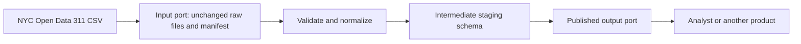

# Architecture

## Product scope

Civic Service Requests is one domain data product in a learning project. It publishes documented NYC 311 data for analysis by request date, agency, problem category, borough, and location.

The project demonstrates product boundaries, contracts, and quality expectations on a single source. It does not claim to model independent teams or prove organizational data mesh governance.

## Data flow

- **Input port:** a bounded CSV extract from NYC Open Data. Later work can add other source formats.
- **Raw layer:** unchanged CSV pages and a manifest. The manifest records the source, requested window, retrieval time, counts, sizes, and checksums. It marks the run complete only after all pages are written.
- **Intermediate layer:** validated and normalized records in a private `staging` schema. Its table layout can change as the pipeline learns more about the source.
- **Output port:** the documented contract in the `products` schema. Consumers depend on this interface rather than raw files or staging tables.

The draft schema and quality expectations live in [the data product contract](data-product.md) and machine-readable [product.yaml](../product.yaml).

## Local first

The first version runs on a laptop: raw pages are files on disk, and the intermediate table and output view live in one DuckDB file. A cloud account is not required until [part 6](roadmap.md).

Cloud access sits behind small interfaces, such as a raw store with read and write operations for pages and manifests. Part 6 adds Cloud Storage and BigQuery implementations without changing the pipeline steps or the product fields. Pure transformations and `--help` never need credentials.

Planned cloud shape, to be confirmed in part 6: one project, with Cloud Storage and BigQuery co-located in `europe-west2`, a staging dataset `civic_services_staging`, and a consumer dataset `civic_services_products`.

## Runtime

One installable Python package exposes the `civic-data` Typer CLI. Command options are validated at the boundary with Pydantic. Masoora wires the internal steps in process; it is not durable storage, a scheduler, or a persistent catalog.

The planned pipeline commands are:

1. `land-raw` fetches the bounded source batch and writes original pages plus a manifest.
2. `build-intermediate` reads a completed raw run, validates and normalizes it, and merges staging data.
3. `publish-product` checks quality and replaces the consumer-facing output.
4. `run-daily` calls the required stages in sequence for the first scheduled job (part 7).

## Reliability boundaries

- Each run receives a unique run ID (a UTC timestamp plus a short random suffix, so listings sort by time) and preserves its source input for replay. See [ADR 0001](adr/0001-run-completeness-and-reconciliation.md).
- Downstream stages read only runs that have a completion manifest, and take the latest complete run for a batch.
- A page request that fails stops the run by default. `--retries` sets a bounded number of retries per page; a run that exhausts them stays incomplete, and its pages are kept.
- Paging is not locked. Rows can be skipped or repeated at page boundaries while the live source changes. The manifest counts repeated `unique_key` values and records the source's own count as an observation; a later run of the same batch catches skipped rows.
- Writes must be safe to retry; a rerun of the same batch must not duplicate output.
- The NYC source may revise older records. A created-date window is a bounded batch, not a complete incremental-change strategy.
- No freshness SLA is published until update behavior and scheduled runs have been measured.
