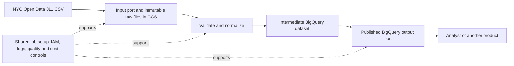

# Architecture

## Product scope

Civic Service Requests is the first domain product in a small GCP data mesh reference project. It publishes documented NYC 311 data for analysis by request date, agency, problem category, borough, and location.

The project demonstrates product boundaries, contracts, quality expectations, and shared platform capabilities. It does not claim to model independent teams or prove organizational data mesh governance.

## Data flow

- **Input port:** a bounded CSV extract from NYC Open Data. Later work can add other source formats.
- **Raw layer:** unchanged CSV pages and a manifest in Cloud Storage. The manifest records the source, requested window, retrieval times, counts, sizes, and checksums. It marks the run complete only after all page uploads succeed.
- **Intermediate layer:** validated and normalized records in the private `civic_services_staging` BigQuery dataset. Its table layout can change as the pipeline learns more about the source.
- **Output port:** the documented contract in `civic_services_products`. Consumers depend on this interface rather than raw files or staging tables.
- **Shared platform:** identity, execution, logging, quality, and cost controls. Extract common code after another domain shows which parts are reusable.

The draft schema and quality expectations live in [the data product contract](data-product.md) and machine-readable [product.yaml](../product.yaml).

## Runtime

One installable Python package exposes the `civic-data` Typer CLI. Command options are validated at the boundary with Pydantic. Masoora wires the internal steps and passes compact references through its in-memory catalog; durable data stays in GCS and BigQuery.

The planned pipeline commands are:

1. `land-raw` fetches the bounded source batch and writes original pages plus a manifest to GCS.
2. `build-intermediate` reads a completed raw run, validates and normalizes it, and materializes staging data.
3. `publish-product` checks quality and writes the consumer-facing BigQuery contract.
4. `run-daily` calls the required stages in sequence for the first scheduled Cloud Run Job.

The CLI package and one versioned container image will be reused for local runs and Cloud Run Jobs. GCP owns scheduling, storage, execution, and durable datasets. Masoora does not replace those services or provide a persistent catalog.

## First deployment shape

Use one GCP project to keep the tutorial small. The Cloud Storage bucket and both BigQuery datasets use the London region, `europe-west2`. A dedicated runtime service account gets only the bucket and dataset permissions needed by its commands. Local Terraform provisioning uses Application Default Credentials; Cloud Run uses its attached identity.

Cloud Logging and Cloud Monitoring remain the operational backends. Grafana Cloud is an optional query UI, with no telemetry forwarding. The initial product manifest stays in this repository; a managed catalog is deferred.

## Reliability boundaries

- Each run receives a unique run ID and preserves its source input for replay.
- Downstream stages read only prefixes with a completion manifest.
- BigQuery writes must be safe to retry; scheduler delivery can repeat.
- The NYC source may revise older records. A created-date window is a bounded batch, not a complete incremental-change strategy.
- No freshness SLA is published until update behavior and scheduled runs have been measured.
